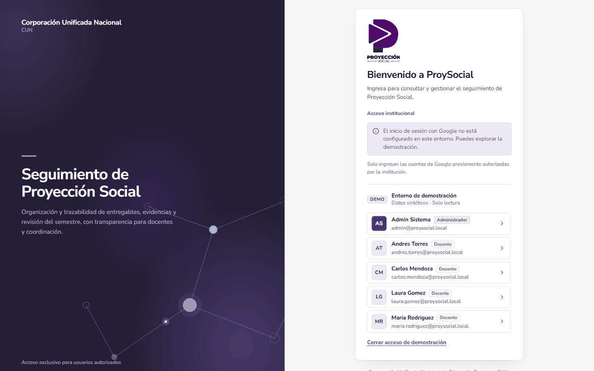
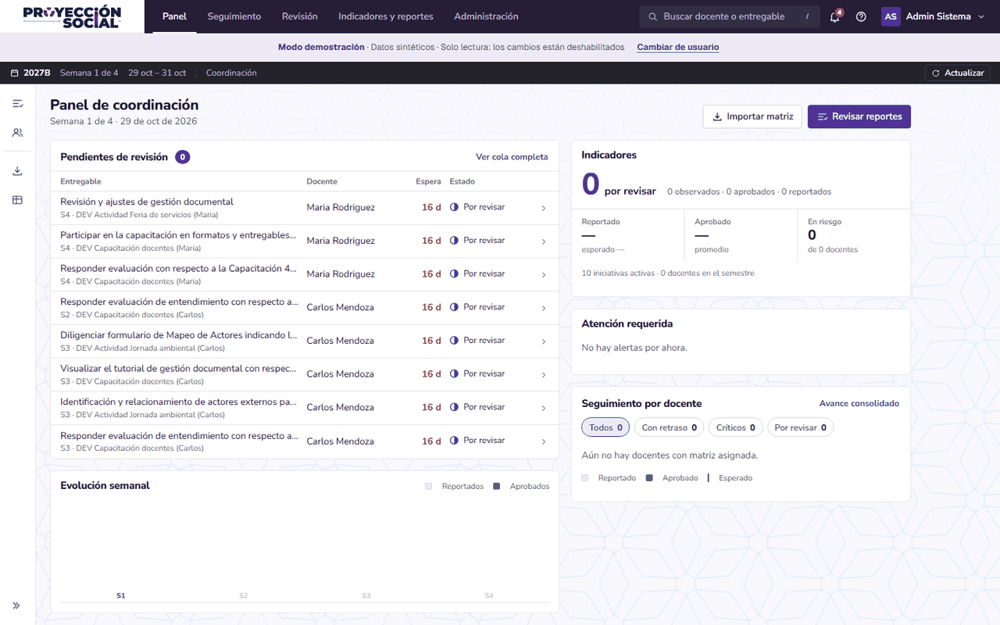
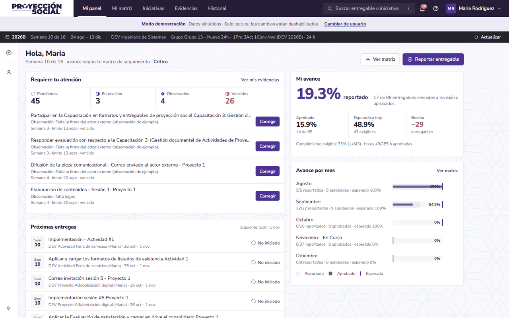
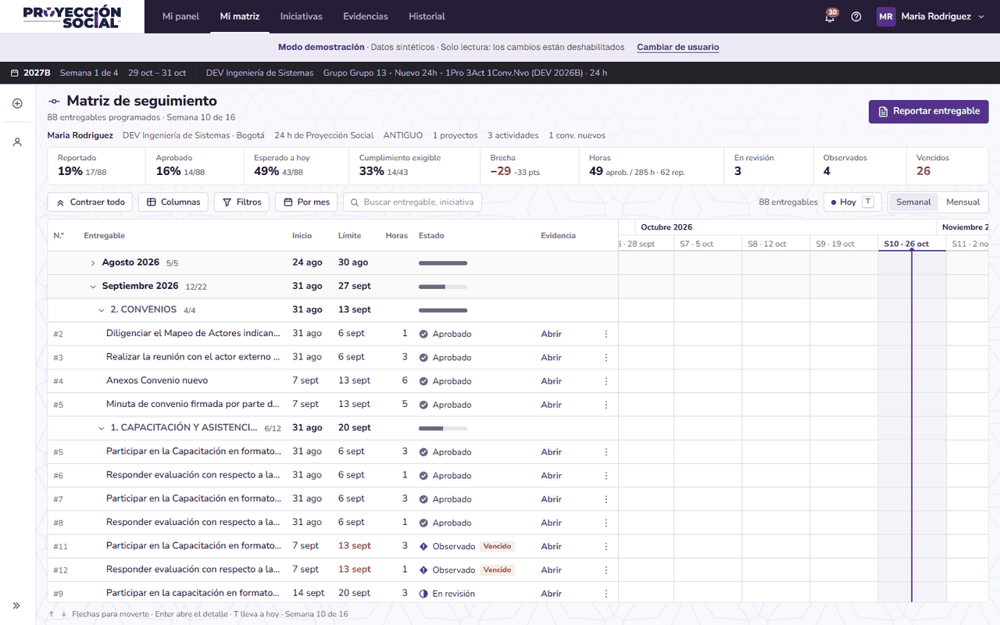
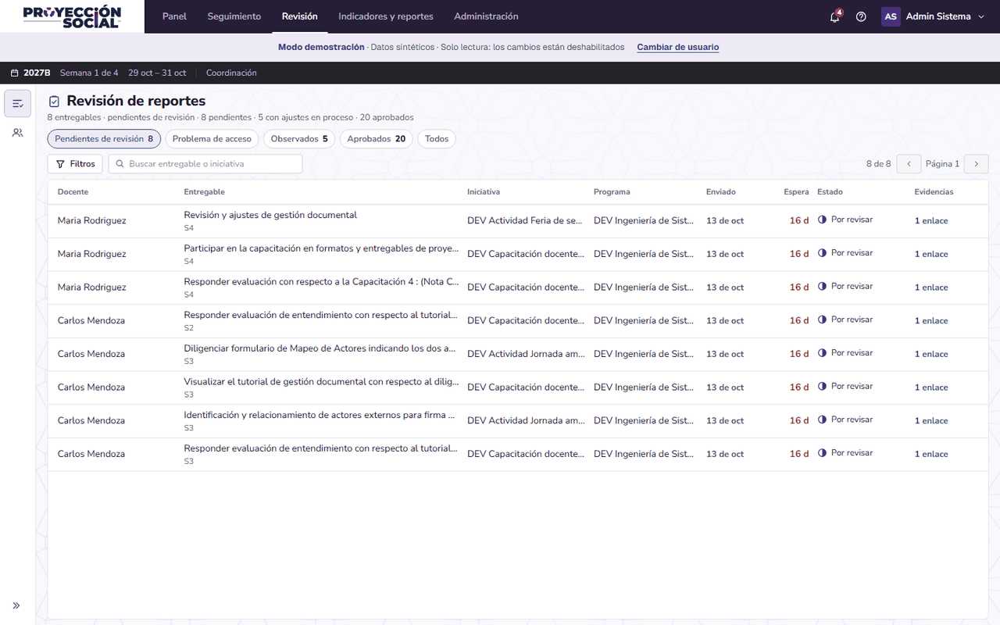
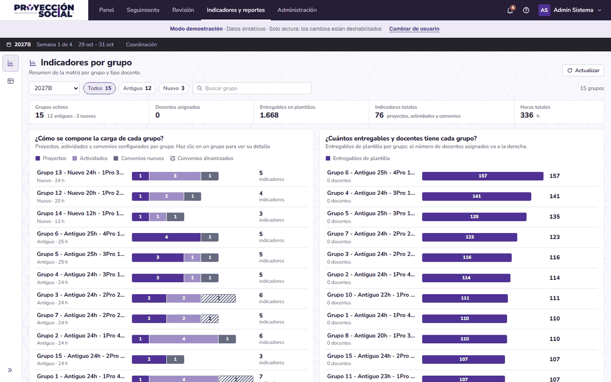
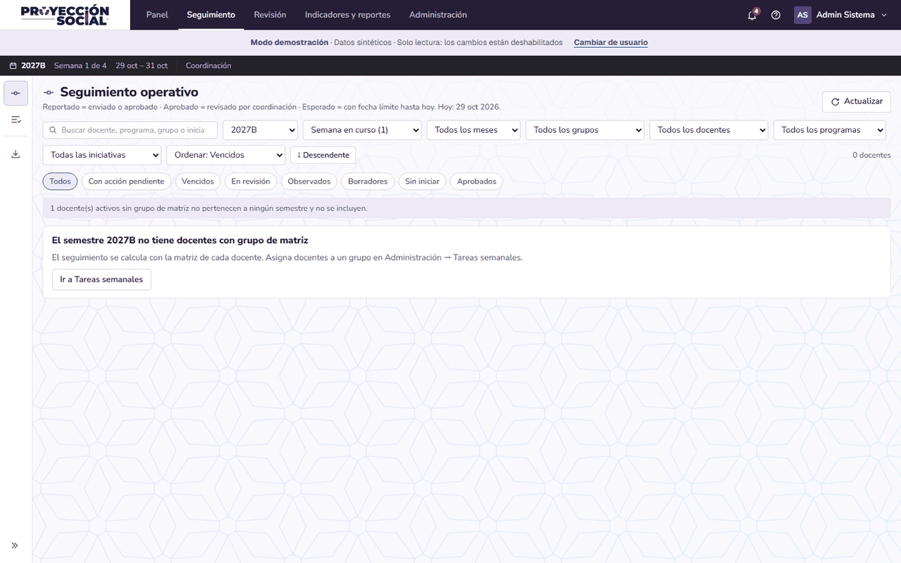
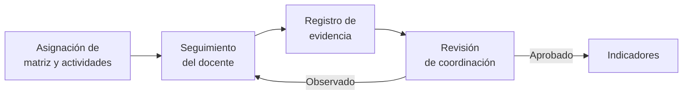
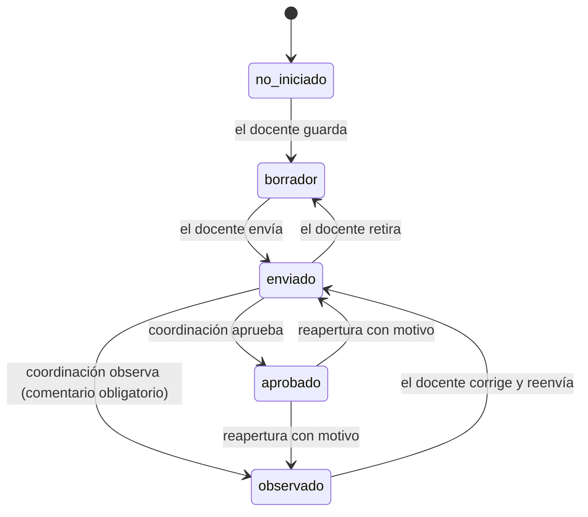
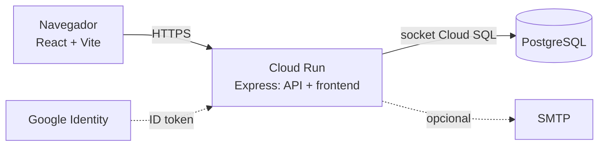

<div align="center">


# ProySocial

**Sistema de gestión y seguimiento de Proyección Social**

Planeación semestral, evidencias, revisión de entregables e indicadores de avance para docentes y coordinación, en una sola plataforma.


[Vista previa](#vista-previa) · [Qué es](#qué-es-proysocial) · [Funcionalidades](#funcionalidades) · [Flujo de trabajo](#flujo-de-trabajo) · [Arquitectura](#arquitectura) · [Ambientes](#ambientes-y-modos-de-acceso) · [Instalación local](#instalación-local) · [Pruebas](#pruebas-y-calidad) · [Despliegue](#despliegue-en-google-cloud) · [Documentación](#documentación-técnica) · [Estado](#estado-del-proyecto)

</div>

> **Versión piloto.** ProySocial está en fase de piloto con datos sintéticos. El inicio de sesión institucional con Google y el envío de correos dependen de configuración externa que **no está confirmada** en el entorno desplegado (ver [Estado del proyecto](#estado-del-proyecto)). El modo de demostración es solo para explorar la interfaz; no está pensado para datos reales.

---

## Vista previa

Capturas del diseño actual (B2) con los usuarios y datos sintéticos del modo de demostración.

<p align="center">
  <br>
  <sub><b>Inicio de sesión</b> · animación de marca y acceso de demostración con cinco usuarios sintéticos</sub>
</p>

<p align="center">
  <br>
  <sub><b>Panel de coordinación</b> · pendientes de revisión, indicadores y evolución semanal</sub>
</p>

<p align="center">
  <br>
  <sub><b>Panel docente</b> · lo que requiere atención, avance personal y próximas entregas</sub>
</p>

<p align="center">
  <br>
  <sub><b>Matriz de seguimiento</b> · entregables por mes, semana y estado, con cronograma</sub>
</p>

<p align="center">
  <br>
  <sub><b>Revisión de entregables</b> · cola de pendientes con espera y evidencias</sub>
</p>

<p align="center">
  <br>
  <sub><b>Indicadores y reportes</b> · composición de la carga y entregables por grupo</sub>
</p>

<p align="center">
  <br>
  <sub><b>Seguimiento operativo</b> · avance consolidado por docente</sub>
</p>

---

## Qué es ProySocial

Los proyectos de Proyección Social se planean por semestre con una matriz de entregables por docente: actividades, convenios, fechas y horas. Llevar ese seguimiento en hojas de cálculo dispersas dificulta saber quién va al día, qué evidencia falta y qué quedó observado.

ProySocial centraliza ese proceso:

- **Una matriz por docente**, derivada de plantillas por grupo y semestre (o importada desde Excel).
- **Evidencias como enlaces.** Cada docente conserva sus archivos en su propio Drive; ProySocial guarda y valida el enlace y su historial. No usa la API de Drive ni almacena archivos.
- **Revisión con trazabilidad.** Cada envío, observación, aprobación o reapertura queda registrado como evento.
- **Indicadores** de avance real frente al esperado, por docente, grupo y semestre.

Está dirigido a **docentes** (reportan y corrigen) y a **coordinación** (revisa, hace seguimiento y administra el semestre).

---

## Funcionalidades

### Portal docente

| Módulo | Qué permite |
|---|---|
| **Mi panel** | Resumen personal: lo que requiere atención (pendientes, en revisión, observados, vencidos), avance y próximas entregas. |
| **Mi matriz** | Todos los entregables del semestre agrupados por mes e iniciativa, con filtros, columnas configurables, vista semanal o mensual y cronograma. |
| **Iniciativas** | Proyectos, actividades y convenios asignados, con su detalle y entregables. |
| **Evidencias** | Estado de la evidencia de cada entregable, qué pidió el revisor y acceso al enlace. |
| **Historial** | Reportes enviados con su trazabilidad (envíos, observaciones, aprobaciones); desde el inspector se corrige y se reenvía lo observado. |
| **Reportar entregable** | Guardar borrador, adjuntar enlaces de evidencia y enviar a revisión; reenviar los observados. |
| **Perfil** | Datos de contacto del docente. |

### Portal administrativo

| Módulo | Qué permite |
|---|---|
| **Panel** | Cola de pendientes de revisión, indicadores del semestre, alertas y evolución semanal. |
| **Seguimiento** | Avance consolidado por docente, con filtros y acceso a la matriz de cada uno. |
| **Revisión** | Aprobar u observar entregables enviados (la observación exige comentario) y reabrir aprobados con motivo. |
| **Indicadores y reportes** | Indicadores por grupo y métricas del semestre. |
| **Administración** | Seis pestañas: usuarios, semestres, escuelas y programas, iniciativas, tareas semanales y plantillas. Incluye la asignación de docentes a grupos de matriz. |
| **Importación de matrices** | Asistente de siete pasos para convertir una matriz de seguimiento en Excel en una plantilla de ProySocial, con validación, previsualización y trazabilidad de la importación. Nada se guarda hasta confirmar. |

Ambos portales muestran notificaciones internas; el envío por correo existe en el código, pero requiere SMTP configurado (ver [Estado del proyecto](#estado-del-proyecto)).

---

## Flujo de trabajo



Estados de un entregable, según las reglas del backend (`backend/src/services/matrizService.js`):



Un entregable **vencido** no es un estado propio: se calcula cuando pasó la fecha límite y aún falta una acción del docente (no iniciado, borrador u observado). Un entregable aprobado queda bloqueado salvo reapertura por un administrador.

---

## Arquitectura

Una sola imagen de contenedor sirve la API y el frontend compilado.



| Capa | Tecnología |
|---|---|
| **Frontend** | React 18, Vite 6, TypeScript 5.8, React Router 7, Tailwind CSS 4, Radix UI, Recharts, Motion. |
| **Backend** | Node.js 22 (imagen Docker), Express 4, `pg`, `jsonwebtoken`, `google-auth-library`, `nodemailer`. API REST con módulos `auth`, `docente`, `admin`, `catalogo` e `importaciones`. |
| **Persistencia** | PostgreSQL 18 (piloto en Cloud SQL). Migraciones SQL versionadas ejecutadas por `backend/scripts/migrate.js`. |
| **Infraestructura** | Docker multi‑etapa, Artifact Registry, Cloud Run, Cloud SQL, Secret Manager. |

**Seguridad implementada**

- Inicio de sesión institucional con Google: el backend verifica el ID token, exige correo verificado, puede restringir por dominio (`ALLOWED_GOOGLE_DOMAINS`) y **no crea usuarios**: la cuenta debe estar registrada y activa.
- Sesión con JWT firmado con `JWT_SECRET` (`SESSION_TTL`, 8 h por defecto). El rol y el estado del usuario se consultan en la base en cada petición, de modo que inactivar un usuario revoca su acceso de inmediato.
- Roles `admin` y `docente`: las rutas `/admin` exigen administrador y el docente solo accede a sus propios datos.
- Escrituras de los entregables en transacciones con bloqueo de fila y registro de eventos.
- Los accesos de desarrollo y de demostración están desactivados salvo configuración explícita (ver [Ambientes](#ambientes-y-modos-de-acceso)).

---

## Modelo de datos y trazabilidad

El esquema se construye con **35 migraciones** (`backend/migrations/`, listadas en `backend/scripts/migrate.js`). La última, `fase28_docente_grupo_matriz.sql`, está protegida por una compuerta (`PROYSOCIAL_APLICAR_FASE28=1`) porque debe aplicarse junto con el código que la usa; sin esa variable el ejecutor la omite con un aviso.

| Concepto | Tablas principales |
|---|---|
| Semestres, escuelas y programas | `semestres`, `escuelas`, `programas` |
| Usuarios y roles | `usuarios` |
| Grupos de matriz y plantillas semanales | `grupos_matriz`, `plantilla_entregables` |
| Iniciativas y docentes asignados | `proyectos`, `proyecto_docentes`, `proyecto_semanas` |
| Entregables y revisión | `proyecto_entregables`, `entregable_eventos` |
| Evidencias (enlaces, versiones) | `entregable_evidencias` |
| Historial docente–grupo | `docente_grupo_matriz`, `docente_grupo_matriz_cambios`, `docente_grupo_matriz_incidencias` |
| Importaciones y actualizaciones masivas | `importaciones_matriz`, `actualizaciones_masivas_entregables` |
| Notificaciones | `notificaciones`, `notificacion_lecturas`, `notificacion_correos` |

Las evidencias **nunca se borran**: un enlace cambiado queda como «reemplazado» y uno que no llegó a enviarse como «retirado». Las protecciones de los semestres históricos y el detalle del modelo están en la [documentación técnica](#documentación-técnica).

---

## Ambientes y modos de acceso

Son tres mecanismos de acceso independientes. No deben confundirse.

| | Desarrollo local | Piloto en Cloud Run | Autenticación institucional |
|---|---|---|---|
| **Base de datos** | `proysocial_dev` (local) | `proysocial_piloto` (Cloud SQL) | La del ambiente donde se active |
| **Datos** | Sintéticos | Sintéticos | Reales |
| **Acceso** | Selector **DEV**: un clic con cualquiera de los cinco usuarios | Modo **DEMO**: cinco usuarios sintéticos, sesiones de 2 h, solo lectura | Google OAuth |
| **Activación** | `DEV_LOGIN_ENABLED=true` (solo con `npm run dev:local`) | `DEMO_ENABLED=true` y `DEMO_PUBLIC_READONLY=true` | `GOOGLE_CLIENT_ID` y `VITE_GOOGLE_CLIENT_ID` |
| **Escritura** | Sí (base de pruebas) | **Bloqueada en el servidor** | Según rol |

- **DEV** nunca se activa en Cloud Run. El backend solo monta `/auth/dev` si la variable está activa.
- **DEMO** emite sesiones con alcance `demo`. El servidor rechaza con 403 todo método distinto de GET, HEAD y OPTIONS, y bloquea además las rutas administrativas de usuarios, correos e importaciones, incluso en lectura. Solo funciona sobre la base `proysocial_piloto` y se deshabilita si esa base contiene usuarios distintos de los cinco sintéticos o cuentas con Google vinculado. Existe también una variante protegida con clave (`DEMO_ACCESS_KEY`). **No es un mecanismo para manejar datos reales.** Detalle en [`docs/DEMOSTRACION_PILOTO.md`](docs/DEMOSTRACION_PILOTO.md).
- **Google OAuth** está implementado y auditado en código, pero su configuración (cliente OAuth y dominios autorizados) está pendiente en el piloto: allí el login lo indica con un aviso.

---

## Instalación local

Ejemplos para **Windows (CMD)**.

### 1. Requisitos

- Node.js 20.6 o superior (la imagen de producción usa Node 22) y npm.
- PostgreSQL en el equipo, con un usuario que pueda crear bases de datos.
- Git. Chrome o Chromium solo si va a ejecutar las pruebas E2E.

### 2. Clonar e instalar dependencias

```bat
git clone https://github.com/haiderbellocun/Proyeccion_social.git
cd Proyeccion_social
npm ci
cd backend
npm ci
cd ..
```

### 3. Variables de entorno

```bat
copy .env.example .env
copy backend\.env.example backend\.env
```

- `.env` (frontend): `VITE_API_URL=http://localhost:4000`. `VITE_GOOGLE_CLIENT_ID` solo se necesita para probar Google.
- `backend\.env`: complete `PGHOST`, `PGPORT`, `PGUSER` y `PGPASSWORD` con las credenciales de su PostgreSQL local. Nunca versione este archivo (está en `.gitignore`).

### 4. Base de datos de pruebas y migraciones

```bat
cd backend
npm run dev:setup
```

Crea la base aislada `proysocial_dev` (solo esa), aplica las migraciones, siembra datos sintéticos (semestre 2026B y cinco usuarios `@proysocial.local`) y genera `backend\.env.dev`. Es idempotente; `npm run dev:setup -- --reset` recrea únicamente `proysocial_dev`. La migración `fase28` queda pendiente si no define `PROYSOCIAL_APLICAR_FASE28=1`.

### 5. Arrancar el backend

```bat
npm run dev:local
```

Usa `backend\.env.dev` (base `proysocial_dev`, `DEV_LOGIN_ENABLED=true`) y escucha en `http://localhost:4000`.

> **No use `npm run dev` del backend para el acceso rápido.** Ese script carga `backend\.env`, cuya base puede ser otra (por ejemplo la legada `app_proyecion`) y no monta el selector DEV.

### 6. Arrancar el frontend

En otra terminal, desde la raíz del repositorio:

```bat
npm run dev
```

Abra `http://localhost:5173`.

### 7. Verificar

- `http://localhost:4000/health` responde `200` si la base conecta.
- El login muestra el selector DEV con Admin Sistema, María Rodríguez, Carlos Mendoza, Andrés Torres y Laura Gómez.
- `npm run typecheck` (raíz) termina sin errores.

---

## Pruebas y calidad

| Qué | Comando | Dónde |
|---|---|---|
| Tipos (TypeScript) | `npm run typecheck` | raíz |
| Compilación de producción | `npm run build` | raíz |
| Unitarias y guardas estáticas (reglas de entregables, evidencias, importación, selector de login, modo demo) | `npm test` | `backend` |
| Base de integración aislada `proysocial_test` | `npm run test:db:setup` | `backend` |
| Integración protegida: históricos, métricas, asignación docente–grupo, recorrido del piloto, seguimiento operativo | `npm run test:integration:protegidos` | `backend` |
| Integración completa (incluye modo demo, que requiere una base local `proysocial_piloto`; sin ella esas pruebas se omiten) | `npm run test:integration` | `backend` |
| E2E por navegador real (Chrome por CDP): roles y permisos, matrices, revisión, evidencias, importador, administración, indicadores, modo demo, login animado y responsive a 1440, 1280, 820 y 390 px | `npm run e2e` | raíz |

Las suites E2E y su alcance están descritas en [`e2e/README.md`](e2e/README.md). Requieren el backend (`npm run dev:local`) y el frontend (`npm run dev`) en marcha y Chrome instalado. Se ejecutan **en serie**, contra bases locales aisladas, y las capturas se guardan en `e2e/salida/` (ignorada por git). Las pruebas de integración crean sus propios datos sintéticos y no deben apuntarse a bases con datos reales.

---

## Despliegue en Google Cloud

El piloto se ejecuta como servicio en **Cloud Run**, con imagen en **Artifact Registry**, base **Cloud SQL** (PostgreSQL), credenciales en **Secret Manager** y una cuenta de servicio con acceso mínimo. La imagen (`Dockerfile`) tiene tres etapas: compila el frontend, instala las dependencias de producción del backend y ejecuta `node backend/src/index.js` como usuario no root en el puerto 8080.

Los comandos siguientes usan variables; **no contienen secretos** y ninguno modifica datos. Cree las variables con los valores de su proyecto.

```bat
set PROJECT=<proyecto>
set REGION=<region>
set SERVICE=<servicio-cloud-run>
set IMAGEN=%REGION%-docker.pkg.dev/%PROJECT%/<repositorio>/proysocial:<etiqueta>
```

**1. Construir la imagen.** El `Dockerfile` exige el secreto de construcción `npm_ca` (certificado CA para `npm`, necesario detrás de proxies corporativos); `VITE_API_URL` va vacío porque la API se sirve desde el mismo origen.

```bat
docker build --secret id=npm_ca,src=%NPM_CA_PEM% --build-arg VITE_API_URL= --build-arg VITE_GOOGLE_CLIENT_ID= -t %IMAGEN% .
```

**2. Publicarla.**

```bat
gcloud auth configure-docker %REGION%-docker.pkg.dev --quiet
docker push %IMAGEN%
```

**3. Crear una revisión de prueba sin tráfico**, con una etiqueta para validarla en su propia URL.

```bat
gcloud run services update %SERVICE% --project %PROJECT% --region %REGION% --image %IMAGEN% --no-traffic --tag candidata
```

**4. Validar antes de mover tráfico.** Con la URL de la revisión etiquetada:

- `GET /health` debe responder `200` (conexión efectiva con la base).
- El login debe mostrar el acceso esperado para el ambiente y no exponer `/auth/dev`.
- En el piloto con demo público, el script de humo comprueba además lectura, escrituras bloqueadas y los cinco perfiles:

```bat
set DEMO_URL=<url-de-la-revision-etiquetada>
node backend\scripts\demo-publico-humo.mjs
```

**5. Transferir el tráfico** solo si todo es correcto.

```bat
gcloud run services update-traffic %SERVICE% --project %PROJECT% --region %REGION% --to-tags candidata=100
```

**6. Revertir** a la revisión anterior (`gcloud run revisions list` muestra los nombres).

```bat
gcloud run services update-traffic %SERVICE% --project %PROJECT% --region %REGION% --to-revisions <revision-anterior>=100
```

Las migraciones de Cloud SQL **no se ejecutan al desplegar**: tienen su propia guía, [`docs/MIGRACIONES_CLOUD_SQL_PILOTO.md`](docs/MIGRACIONES_CLOUD_SQL_PILOTO.md). La puesta en marcha completa del piloto está en [`docs/LANZAMIENTO_PILOTO_PROYSOCIAL.md`](docs/LANZAMIENTO_PILOTO_PROYSOCIAL.md).

> **Workflow de GitHub Actions.** El repositorio incluye `.github/workflows/deploy-cloud-run.yml`, que se dispara al hacer push a `main` (o manualmente): construye la imagen, ejecuta las migraciones mediante un job de Cloud Run y despliega el servicio. Requiere variables y credenciales del repositorio cuya configuración no está verificada aquí. El piloto se despliega **manualmente** con el procedimiento anterior; `docs/piloto/deploy-piloto.yml.propuesta` es solo una propuesta.

---

## Documentación técnica

| Documento | Contenido |
|---|---|
| [`docs/DEMOSTRACION_PILOTO.md`](docs/DEMOSTRACION_PILOTO.md) | Modo demo: funcionamiento, seguridad, variables, pruebas y riesgos. |
| [`docs/LANZAMIENTO_PILOTO_PROYSOCIAL.md`](docs/LANZAMIENTO_PILOTO_PROYSOCIAL.md) | Guía operativa de lanzamiento del piloto. |
| [`docs/MIGRACIONES_CLOUD_SQL_PILOTO.md`](docs/MIGRACIONES_CLOUD_SQL_PILOTO.md) | Revisión de las migraciones y su aplicación en Cloud SQL. |
| [`docs/MIGRACION_DATOS_PILOTO_GCP.md`](docs/MIGRACION_DATOS_PILOTO_GCP.md) | Carga de datos sintéticos al piloto. |
| [`docs/AUDITORIA_BACKEND_PROYSOCIAL.md`](docs/AUDITORIA_BACKEND_PROYSOCIAL.md) | Auditoría del backend. |
| [`docs/PLAN_FORTALECIMIENTO_BACKEND.md`](docs/PLAN_FORTALECIMIENTO_BACKEND.md) | Plan de fortalecimiento del backend. |
| [`docs/BACKEND_BLOQUE1_2_CIERRE_FINAL.md`](docs/BACKEND_BLOQUE1_2_CIERRE_FINAL.md) | Cierre de la protección de históricos. |
| [`docs/BACKEND_BLOQUE2_METRICAS_SEMESTRE.md`](docs/BACKEND_BLOQUE2_METRICAS_SEMESTRE.md) | Métricas por semestre. |
| [`docs/BACKEND_BLOQUE3B_FASE_B.md`](docs/BACKEND_BLOQUE3B_FASE_B.md) | Historial docente–grupo (aplicación coordinada de `fase28`). |
| [`docs/CORREOS_NOTIFICACIONES.md`](docs/CORREOS_NOTIFICACIONES.md) | Notificaciones y correos. |
| [`docs/CIERRE_FUNCIONAL_PROYSOCIAL.md`](docs/CIERRE_FUNCIONAL_PROYSOCIAL.md) | Cierre funcional y matriz de módulos. |
| [`docs/PRODUCCION.md`](docs/PRODUCCION.md) | Datos necesarios para producción. |
| [`docs/B2_INTEGRACION_ETAPA1.md`](docs/B2_INTEGRACION_ETAPA1.md) | Integración del diseño B2 (etapas 1 a 5A en `docs/`). |
| [`e2e/README.md`](e2e/README.md) | Suites E2E. |

---

## Estado del proyecto

**Implementado**

- Portales docente y administrativo con el diseño B2, sobre el flujo completo de entregables, evidencias por enlace, revisión e historial.
- Importación de matrices desde Excel y administración de semestres, escuelas, programas, iniciativas, tareas semanales y plantillas.
- Seguimiento operativo e indicadores por docente, grupo y semestre.
- Protección de semestres históricos y trazabilidad de eventos.
- Entorno local reproducible con datos sintéticos y modo de demostración de solo lectura para el piloto.

**Disponible en el piloto**

- Servicio en Cloud Run con base `proysocial_piloto` y acceso DEMO de solo lectura (ver [`docs/DEMOSTRACION_PILOTO.md`](docs/DEMOSTRACION_PILOTO.md)). Antes de mover tráfico a cualquier revisión debe comprobarse que `GET /health` responde `200`.

**Requiere configuración institucional**

- Cliente OAuth de Google y dominios autorizados para el acceso institucional real.
- SMTP para el envío de correos (el código existe; sin configuración los correos no salen).
- Carga de datos institucionales reales y su validación (ver [`docs/PRODUCCION.md`](docs/PRODUCCION.md)).
- Configuración y verificación del workflow de GitHub Actions si se desea despliegue automatizado.

**Pendiente o planificado**

- Aplicar `fase28` (historial docente–grupo) de forma coordinada en los ambientes que corresponda.
- Validación con usuarios reales antes de un uso institucional en producción.
